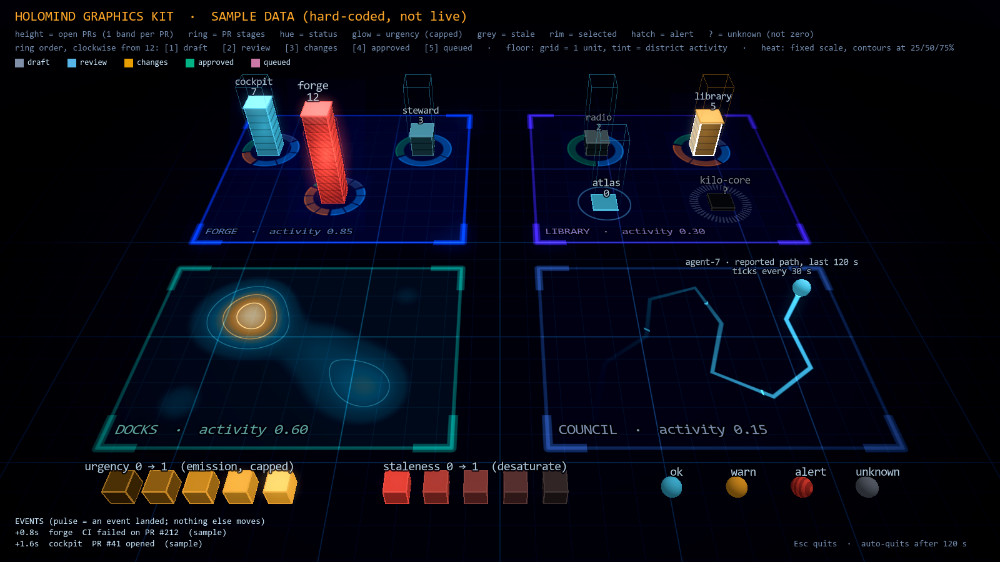

# HOLOMIND Graphics Playbook

This playbook covers zero-asset, code-only graphics that carry information. It was written for the
HOLOMIND cockpit and for a later facelift of the colony's other Godot games.

**The rule behind every entry:** each visual channel encodes one named fact, from one named source,
on a fixed scale. If you cannot say what a glow, a motion or a colour *means*, delete it.
Motion happens only when a real event lands. The repo's `AGENTS.md` also requires that unknown,
offline and stale states stay distinguishable. Most of the honesty rules below enforce that.

- **Kit:** `shaders/kit/*.gdshader` and `scripts/kit/*.gd`.
- **Demo:** `scenes/kit/KitDemo.tscn`, which shows sample data that is labelled on screen.
- **Receipt:** `receipts/kit-demo.png`, rendered off-screen on the i3 rig (GTX 1070 Ti,
  Godot 4.7.1, Compatibility renderer).
- **Constraints:** everything is procedural, with no images, models or fonts on disk; text uses
  `SystemFont`. The budget is at most 5% of one core when idle and at most 300 MB.



## Contents

1. [Measured costs](#measured-costs)
2. [Renderer notes (Compatibility vs Forward+)](#renderer-notes)
3. [The kit](#the-kit)
4. [Technique catalogue](#technique-catalogue): 24 techniques, each with what it encodes, its cost, its renderer, code, and honesty rules
5. [Palettes](#palettes)
6. [Top 5 for the cockpit](#top-5-for-the-cockpit)
7. [Checklist for a new visual](#checklist-for-a-new-visual)

---

## Measured costs

The run was `KitDemo.tscn` at 1600×900, with the window off-screen at (12000, 12000), on the i3 rig
(8 logical cores, GTX 1070 Ti, driver 581.80, OpenGL 3.3 Compatibility). CPU is the kernel plus
user time of the real `Godot_v4.7.1-stable_win64.exe` child, read from WMI, starting 8 s after
launch and running for 30 s.

| Mode | CPU over 30 s | % of one core | Working set | GPU util (nvidia-smi, whole card) |
|---|---|---|---|---|
| **Idle** (`--background`; nothing changes; `low_processor_usage_mode`, 30 fps cap) | **0.00 s** | **0.0 %** | 177 MB | 10–15 % (the same as the baseline from other processes) |
| Always redrawing (`--continuous`; 30 fps; the same scene) | 2.63 s | 8.6 % | 177 MB | 19–25 % (about 9 points above the baseline) |
| Start-up (first 8 s: import, shader compile, building the scene) | 1.75 s | n/a | n/a | n/a |

What this means:

- **A still scene is effectively free.** It costs 0 % CPU and stays within the 300 MB memory
  budget. Keep it that way: any shader that reads `TIME`, and any per-frame `set_shader_parameter`,
  turns the scene into the "always redrawing" row, which uses about 8.6 % of a core. That alone is
  over the 5 % budget.
- **None of the kit shaders read `TIME`.** Everything that changes does so because a script set a
  uniform in response to data.
- The pulse in `ExtrudedBar.gd` runs `_process` only while it decays (1.2 s), then switches itself
  off. `DataTrail.gd` rebuilds its mesh only when a sample lands or when `set_now()` is called.

## Renderer notes

The cockpit's `project.godot` uses **`gl_compatibility`**. Every kit file works in both renderers.

| Need | Compatibility (GL 3.3) | Forward+ (Vulkan/D3D12) |
|---|---|---|
| Unshaded spatial shaders, `fwidth`, uniform arrays | yes | yes |
| `blend_add` transparent passes (rings, trails, heat, halos) | yes | yes |
| Environment glow (bloom) | Weak on this rig. The 3D target has a low dynamic range, so thresholds above about 0.5 produced no visible bloom. Use `halo_card.gdshader` for urgency halos you can trust. | A real HDR target. `glow_hdr_threshold` of 1.0 or more cleanly separates emissive values above 1. |
| Depth fog | yes | yes, plus volumetric fog (avoid: it costs GPU every frame) |
| `Label3D` with an MSDF `SystemFont` | yes | yes |
| Visibility ranges (LOD fade) | yes | yes |
| SSAO, SSR, SDFGI, volumetrics | no | yes (avoid in the cockpit: per-frame GPU cost and no information) |
| GPU particles | `GPUParticles3D` works, with fewer features | full |

> **Tested on this rig, Compatibility:** glow with `GLOW_BLEND_MODE_SCREEN` at threshold 0.0 gave a
> strong whole-scene bloom; at 0.45 it was faint; at 0.7 it gave none. Earlier runs used
> `GLOW_BLEND_MODE_ADDITIVE` with thresholds 0.5 to 0.85 and also showed no visible glow. The
> blend mode was not isolated from the threshold. The demo therefore uses screen mode at 0.5 for
> mild atmosphere, and leaves urgency to halo cards.

## The kit

| File | What it is |
|---|---|
| `shaders/kit/data_emissive.gdshader` | Encodes status as hue, urgency as capped emission, staleness as desaturation, selection as a fresnel rim plus white edges, a real event as a pulse, alert as hatching, and quantity as unit bands. It also draws box-edge wires. |
| `shaders/kit/district_floor.gdshader` | A procedural grid with antialiasing and distance fade. It draws up to 8 district rectangles, with a tint, a fill set by activity, a border and corner brackets, plus a vignette. |
| `shaders/kit/stage_rings.gdshader` | A ring split into stage arcs, with arc length set by count and one notch per item. A real zero and an unknown are drawn differently. |
| `shaders/kit/trail.gdshader` | A ribbon that fades by real sample age, with age ticks every N seconds. |
| `shaders/kit/heat_field.gdshader` | Density from up to 16 point uniforms, on a fixed scale, with contour lines and a ramp that stays legible in greyscale. |
| `shaders/kit/halo_card.gdshader` | A billboard additive glow card whose intensity is exactly the number you pass in. |
| `scripts/kit/ExtrudedBar.gd` | A building whose height is a value. It has unit bands, a capped glow cap plate, a ghost threshold outline, an urgency halo, an MSDF label with LOD, a zero plinth and an unknown stub. |
| `scripts/kit/DataTrail.gd` | Builds the trail mesh from `add_sample(pos, t)` and `set_now(t)`. It never smooths or invents points. |
| `scripts/kit/KitDemo.gd` + `scenes/kit/KitDemo.tscn` | The demo with a hard-coded sample dataset. Esc quits; it also quits after `--timeout` (120 s by default). |

**Run the demo** (off-screen, from the repo root):

```sh
godot --headless --audio-driver Dummy --path . --import          # once per worktree
godot --audio-driver Dummy --path . --windowed --resolution 1600x900 --position 12000,12000 \
      res://scenes/kit/KitDemo.tscn -- --shot=<abs path>/receipts/kit-demo.png
```

The script moves the window to (12000, 12000) itself and prints `window_at=`, because Godot 4.7.1
clamps `--position` onto the screen. Other flags: `--background` (off-screen idle run, for
measurement), `--continuous` (redraws every frame, to probe cost), and `--timeout=<s>`.

---

## Technique catalogue

Each entry gives:

- **Encodes:** the information it carries.
- **Cost:** GPU and CPU.
- **Renderer:** which renderer it needs. "Any" means Compatibility and Forward+.
- **Code:** a kit file or a snippet.
- **Honesty:** what turns it into theatre.

### 1. Emissive intensity = load or urgency

- **Encodes:** how much a thing needs attention now: queue depth, error rate, or time past an SLA.
- **Cost:**
  - GPU: one multiply per pixel.
  - CPU: none until the value changes.
- **Renderer:** any.
- **Code:** `data_emissive.gdshader`:

  ```glsl
  float level = mix(emission_floor, emission_cap, urgency);
  ```

  Urgency is linear in brightness. Above 1.0 the colour gains equal white on every channel (a hot
  core) instead of clipping.
- **Honesty:**
  - Map urgency through a fixed, documented function of the source number, not a per-frame
    "normalise to max". Otherwise a quiet day glows as bright as a crisis.
  - **Cap it** (`emission_cap`): one emergency must never wash out the rest of the screen.
  - Never let brightness carry two meanings: if glow means urgency, selection cannot also glow.

### 2. Hue = status

- **Encodes:** a categorical state: ok, warn, alert, or unknown.
- **Cost:** none (a uniform).
- **Renderer:** any.
- **Code:** `status_color` in `data_emissive.gdshader`. See also [Palettes](#palettes).
- **Honesty:**
  - Keep four hues at most, and keep their meanings fixed across every scene in the colony.
  - Hue is **never the only channel**: alert also hatches (technique 17), and unknown is grey with
    a "?".
  - Preserve hue under brightness. The kit scales the colour so its largest channel is 1.0 before
    it overdrives, because per-channel clipping turns amber yellow and red pink, which makes the
    hue lie.

### 3. Saturation = staleness or age

- **Encodes:** how old the fact is, relative to its expected refresh interval.
- **Cost:** none.
- **Renderer:** any.
- **Code:** `data_emissive.gdshader`. Hue moves toward grey by `staleness * 0.85`, and brightness
  drops by `staleness * 0.55`.
- **Honesty:**
  - Compute staleness as `clamp((now - observed_at) / expected_interval - 1, 0, 1)` from the
    **source's own timestamp**, never from when the cockpit last redrew.
  - A stale red must look less trustworthy than a fresh red, so desaturate; don't only dim.
  - Stale is not unknown: a probe that failed is grey with a "?" (technique 20), not merely
    desaturated.

### 4. Pulse only on events

- **Encodes:** "something just happened here", such as a PR opened, CI failing, or a receipt
  landing.
- **Cost:**
  - GPU: none.
  - CPU: about 1.2 s of `_process` per event, then off.
- **Renderer:** any.
- **Code:** `ExtrudedBar.pulse()` sets `event_pulse = 1`, decays with an ease-out, then calls
  `set_process(false)`.
- **Honesty:**
  - Every pulse must have a **text receipt**. The demo's EVENTS ticker lists what fired, and when.
  - Never drive a pulse from `TIME` or `sin()`, and never use an idle "breathing" animation.
  - When events arrive faster than the eye can follow (more than about 2/s on one object), merge
    them into a count and leave the glow on rather than strobing.

### 5. Trails = recent history

- **Encodes:** where a mover really was, and how recently.
- **Cost:**
  - GPU: one additive ribbon.
  - CPU: a mesh rebuild per sample, about 2 vertices per sample, with a 256-sample cap.
- **Renderer:** any.
- **Code:** `DataTrail.gd` and `trail.gdshader`. `UV.x` holds the sample time and `now_s` is a
  uniform. Ticks mark every `tick_every_s` of age.
- **Honesty:**
  - Use straight segments between real samples, with **no splines and no extrapolation**: a curve
    between samples invents positions.
  - The age fades against a clock that you advance (`set_now`), and that clock comes from the
    source.
  - When the mover stands still, refresh the last sample's time and add no geometry. A long dwell
    must not look like movement.
  - Keep the UV epoch recent (seconds since session start), because 32-bit float UVs lose
    precision past about 10⁶ s.

### 6. Height or extrusion = quantity

- **Encodes:** counts or amounts, such as open PRs, queue length, or GB used.
- **Cost:**
  - GPU: one box.
  - CPU: none until the value changes.
- **Renderer:** any.
- **Code:** `ExtrudedBar.gd` sets `height = value * unit_height`, and `unit_height` in
  `data_emissive` draws **one band per unit**, so you can count to 12 by eye.
- **Honesty:**
  - Use a linear scale only, and start bars at the floor; a truncated baseline exaggerates
    differences.
  - Give the height a reference: the ghost outline marks `max_value` (a threshold or capacity).
  - **Zero is drawn**, as a 4 cm plinth, so "zero PRs" never looks like "repo missing".
  - Keep one `unit_height` per scene, so the heights of different bars are comparable.

### 7. Rings or segments = categorical counts

- **Encodes:** how many items sit in each stage. For PRs the stages are draft, review, changes
  requested, approved, and queued.
- **Cost:**
  - GPU: one quad with a loop of at most 6 stages per pixel.
  - CPU: none.
- **Renderer:** any.
- **Code:** `stage_rings.gdshader`. Arcs run clockwise from 12 o'clock, with arc length set by
  count and one notch per item (up to `max_ticks`).
- **Honesty:**
  - Keep the stage order **fixed** and printed in a legend; never sort by size.
  - When the total is 0, draw a thin continuous ring: a real zero.
  - When `has_data` is 0, draw a **dotted grey** ring: unknown. These two must never look alike.
  - Arc length is a share of the whole. Pair the ring with a bar, or label the total, so share and
    size aren't confused.

### 8. Heat or density field = activity

- **Encodes:** where activity is concentrated, for example events per hour per area.
- **Cost:**
  - GPU: N Gaussians per covered pixel (N ≤ 16). Keep the plane only as big as the area.
  - CPU: none.
- **Renderer:** any.
- **Code:** `heat_field.gdshader`. Points are `vec4(x, z, weight, radius)`, `full_scale` is
  fixed, and contours are drawn at 25, 50 and 75 %.
- **Honesty:**
  - Use a **fixed scale** (`full_scale`) that is printed in the legend. Auto-normalising makes
    noise look like a hotspot.
  - Hide everything below 4 % of the scale: the noise floor is not activity.
  - The radius is a smoothing choice, so state it. Never use a radius large enough to merge
    unrelated machines.

### 9. Fog or depth = distance from attention

- **Encodes:** what is in focus (near) and what is context (far).
- **Cost:**
  - GPU: an exponential fog term per pixel.
  - CPU: none.
- **Renderer:** any. Depth fog only.
- **Code:** in `KitDemo._build_environment()`:

  ```gdscript
  e.fog_enabled = true; e.fog_light_color = C_NAVY; e.fog_density = 0.012
  ```

- **Honesty:**
  - Fog must never hide an alert. An alert's emission or halo should punch through fog; raise its
    `fog` contribution in the shader if needed.
  - Don't use fog as mood. If it doesn't separate focus from context, turn it off.

### 10. Fresnel or rim = selection

- **Encodes:** the object the user selected or is inspecting. This is a UI fact, not a data fact.
- **Cost:** a `pow()` per pixel.
- **Renderer:** any.
- **Code:** in `data_emissive.gdshader`. White-tinted rim:

  ```glsl
  rim = pow(1.0 - dot(NORMAL, VIEW), 3.0) * selected
  ```

  Box edges also turn white and get wider, because a fresnel effect is weak on flat faces.
- **Honesty:** selection is white, so it never borrows a status hue. Only one object is selected
  at a time.

### 11. SDF text and glyphs

- **Encodes:** exact numbers and names, readable at any angle and distance.
- **Cost:**
  - GPU: one MSDF atlas, generated once.
  - CPU: none per frame.
- **Renderer:** any.
- **Code:**

  ```gdscript
  var f := SystemFont.new()
  f.font_names = PackedStringArray(["Cascadia Mono", "Consolas", "monospace"])
  f.multichannel_signed_distance_field = true
  label3d.font = f
  ```

  These are system fonts, so no font files ship. Glyphs such as ▲ ● ◆ ? ! come from the same font
  and can serve as shape channels.
- **Honesty:**
  - The number on a label is the **source value**, not a rounded animation toward it.
  - If a value is estimated, say so ("~12"). If it is unknown, show "?", never "0".

### 12. Scan or sweep = a real sampling interval

- **Encodes:** when the feed was last sampled and when the next sample is due.
- **Cost:**
  - GPU: one line per pixel row.
  - CPU: one uniform update per sample.
- **Renderer:** any.
- **Code:** a snippet, not in the kit. It goes in a floor or panel shader:

  ```glsl
  uniform float last_sample_s; uniform float interval_s; uniform float now_s; // now_s set at 1 Hz, not per frame
  float phase = (now_s - last_sample_s) / interval_s;          // 0 = just sampled, 1 = next sample due
  float x = clamp(phase, 0.0, 1.0);                            // sweep position across the panel
  float line = 1.0 - smoothstep(0.0, fwidth(UV.x) * 2.0, abs(UV.x - x));
  vec3 c = (phase <= 1.0) ? vec3(0.3, 0.84, 1.0) : vec3(1.0, 0.66, 0.16); // overdue -> amber, parked at the edge
  ```

- **Honesty:**
  - The sweep's period **is** the poller's period. If nothing polls, nothing sweeps.
  - A late sample parks the line at the edge in amber. It never wraps round as if all were well.
  - Advance `now_s` at 1 Hz (a 1-unit step is enough). Never use `TIME`, which would cost
    redraws.

### 13. Grid floors with district boundaries

- **Encodes:** scale (1 cell = 1 unit) and membership: which machine, org or repo family a thing
  belongs to.
- **Cost:**
  - GPU: one opaque pass over the floor's pixels, plus an 8-rectangle loop.
  - CPU: none.
- **Renderer:** any.
- **Code:** `district_floor.gdshader`, with `district_rect[]`, `district_tint[]` and
  `district_activity[]`.
- **Honesty:**
  - Districts are real groupings from the source, never layout convenience.
  - The fill brightness is a measured activity rate. Leave it at 0 if you don't have one.
  - The grid fades with distance to avoid moiré, which would read as false density.

### 14. Additive glow with bloom thresholds

- **Encodes:** "over threshold": only values past a stated limit glow.
- **Cost:**
  - GPU: an environment glow pass, which runs only when the frame redraws. Halo cards cost one
    quad of overdraw each.
  - CPU: none.
- **Renderer:** environment glow is reliable in Forward+ and weak in Compatibility (see
  [Renderer notes](#renderer-notes)). `halo_card.gdshader` works with any renderer.
- **Code:** `ExtrudedBar.gd` sets the halo strength to
  `(urgency - halo_threshold) / (1 - halo_threshold)`, capped, plus the event pulse.
- **Honesty:**
  - The threshold is a named number, such as "urgency 0.5" or "SLA breached", and it appears in
    the legend.
  - Glow under the threshold is exactly 0. Never use glow as general ambience on data objects.

### 15. LOD for labels

- **Encodes:** the right amount of detail for the distance: numbers close up, shapes far away.
- **Cost:** reduces cost, because fewer labels are drawn.
- **Renderer:** any.
- **Code:** in `ExtrudedBar.gd`:

  ```gdscript
  label.visibility_range_end = label_lod_m
  label.visibility_range_fade_mode = GeometryInstance3D.VISIBILITY_RANGE_FADE_SELF
  ```

- **Honesty:**
  - Hide labels only where the shape still carries the fact (height, hue).
  - Alerts keep their label at every distance (pass a larger `label_lod_m`).

### 16. Colour-blind-safe palettes

- **Encodes:** the same categories, for every viewer.
- **Cost:** none.
- **Renderer:** any.
- **Code:** see [Palettes](#palettes). The stage colours are derived from Okabe–Ito.
- **Honesty:**
  - Never rely on red against green.
  - Test in greyscale: luminance alone should still order urgency.
  - Pair every hue with a second channel: shape, hatch or text.

### 17. Hatching = alert (redundant channel)

- **Encodes:** the alert state, without relying on hue.
- **Cost:** one `fract()` per pixel.
- **Renderer:** any.
- **Code:** the `hatch` uniform in `data_emissive.gdshader` draws diagonal object-space stripes at
  28 % darkness.
- **Honesty:** hatching means only alert. Don't reuse it as decoration.

### 18. Unit bands = countable quantity

- **Encodes:** the exact count, readable from the shape without a label.
- **Cost:** one `fwidth` and one `fract` per pixel.
- **Renderer:** any.
- **Code:** `unit_height` and `local_base_y` in `data_emissive.gdshader`.
- **Honesty:** one band means one unit. Above about 30 units, switch to bands per 5 and say so.

### 19. Ghost outline = threshold or capacity

- **Encodes:** the limit a quantity is measured against.
- **Cost:** 16 line vertices.
- **Renderer:** any.
- **Code:** `ExtrudedBar._wire_box()`. The top square is bright and the verticals fade, using
  vertex colours.
- **Honesty:** draw it only when the threshold comes from policy or config. Never invent one to
  make a chart "look full".

### 20. Zero against unknown against stale

- **Encodes:** three states that must never look alike.
- **Cost:** none.
- **Renderer:** any.
- **Code:**
  - `ExtrudedBar`: `has_data = false` draws a grey stub with "?". `value = 0` draws a plinth with
    "0".
  - `stage_rings`: a dotted ring means unknown; a faint solid ring means zero.
  - `data_emissive`: staleness desaturates.
- **Honesty:** this is the repo's own rule (`AGENTS.md`: "unknown/offline/stale must remain
  distinguishable"). A failed probe must never render as "all clear".

### 21. Calibration strip (an in-world legend)

- **Encodes:** how to read the scene. The same shader is repeated with one parameter swept from
  0 to 1.
- **Cost:** a handful of small meshes.
- **Renderer:** any.
- **Code:** `KitDemo._build_calibration_strip()`.
- **Honesty:** the legend must use the **same** material and parameters as the data. A legend
  drawn separately can drift from what it explains.

### 22. Edge wires and hologram framing

- **Encodes:** an object's extent, so its footprint and height read against the dark floor.
- **Cost:** a `step()` per axis per pixel.
- **Renderer:** any.
- **Code:** `half_size` and `edge_width` in `data_emissive.gdshader`.
- **Honesty:** edges follow the status hue (or white when selected). Edges must not flicker or
  scan.

### 23. Flights or arcs = a message in transit

- **Encodes:** a real message from A to B, such as a heartbeat, an order or a receipt.
  HOLOMIND already does this.
- **Cost:** one small mesh per message in flight.
- **Renderer:** any.
- **Code:** see HoloMind's `_flights`. Spawn one only when the message is observed.
- **Honesty:**
  - The flight's duration is a display constant, so state it. It is not network latency.
  - When messages arrive faster than a flight lasts, batch them into one flight with a count.

### 24. Small multiples instead of animation

- **Encodes:** change over time, shown side by side (the last N snapshots).
- **Cost:** N times the static cost, and still 0 when idle.
- **Renderer:** any.
- **Code:** instantiate N `ExtrudedBar` rows with a smaller `unit_height`, oldest at the back and
  desaturated by age.
- **Honesty:** each snapshot is a real stored sample with its time printed. Never interpolate
  frames between snapshots.

---

## Palettes

All colours are sRGB. Pass them to `source_color` uniforms as-is; for raw `vec4` array uniforms,
pass `Color.srgb_to_linear()`.

| Role | Colour | Hex | Second channel |
|---|---|---|---|
| Base (background) | dark navy | `#030711` (floor `#040813` + grid) | n/a |
| Status ok | cyan | `#4DD6FF` | none needed |
| Status warn | amber | `#FFA829` | the label |
| Status alert | red | `#FF4538` | **hatching** + halo |
| Status unknown | grey | `#6B7380` | "?" + dotted ring |
| PR draft | slate | `#808FA8` | ring position 1 |
| PR review | sky blue (Okabe–Ito) | `#56B5E8` | ring position 2 |
| PR changes requested | orange (Okabe–Ito) | `#E69E00` | ring position 3 |
| PR approved | bluish green (Okabe–Ito) | `#00B385` | ring position 4 |
| PR queued | reddish purple (Okabe–Ito) | `#CC78A6` | ring position 5 |
| Heat ramp | teal → cyan → amber → pale | see `heat_field.ramp()` | luminance rises monotonically |

- **Amber against red** is close for people with deuteranopia, which is why alert always carries
  hatching and a halo, and why amber is the brighter of the two in luminance.
- **District tints** (blue, violet, teal, steel) are kept dim and cool, so they never compete with
  the status hues.

## Top 5 for the cockpit

These are the five techniques that would most improve HOLOMIND's ability to show what is really
happening, in priority order.

1. **Distinct zero, unknown and stale states, with saturation as staleness (techniques 3 and
   20).**
   - Today, a fact with no age looks as fresh as a live one.
   - Desaturating by `(now - observed_at) / expected_interval`, plus a grey "?" stub for failed
     probes, makes the cockpit honest about how much of it is current. This is already the repo's
     stated rule.
2. **Scan or sweep tied to the real poll interval (technique 12).**
   - One line per feed shows "sampled 4 s ago, next in 6 s".
   - It parks in amber when a feed is late, so a dead feed becomes visible without anyone
     reading timestamps.
3. **Extruded bars with unit bands, plus stage rings (techniques 6, 7 and 18).**
   - The PR pipeline becomes legible at a glance: how many are open, where they are stuck
     (changes requested against review), and which repo crossed its threshold.
   - It is all countable, with no labels needed.
4. **Event-only pulse with a text receipt (technique 4).**
   - Motion means an event, and every flash has a ticker line.
   - This keeps the existing "motion = real events only" contract enforceable, and lets the
     person at the screen trust that a still cockpit means a quiet colony.
5. **Capped urgency emission with threshold halos (techniques 1 and 14).**
   - Attention ranks itself: one halo is the thing to look at.
   - In the Compatibility renderer the halo card is what makes this reliable; environment bloom
     alone is too weak.

Next in line: a **heat field** for fleet activity on a fixed scale (8) and **trails** for agent
movement history (5).

## Checklist for a new visual

1. What single fact does it encode, and which source owns that fact?
2. Is the scale fixed and printed in a legend or calibration strip?
3. Does it change only when the data changes? (No `TIME`, and no per-frame uniform writes.)
4. Are zero, unknown and stale distinguishable?
5. Is hue paired with a second channel?
6. Does it render in Compatibility? Check with an off-screen `--shot`, and look at the PNG.
7. Idle CPU: measure 30 s off-screen. It must stay under 5 % of one core; the kit scene measures
   0 %.
8. Does an Esc, timeout or exit path exist for anything shown fullscreen?
